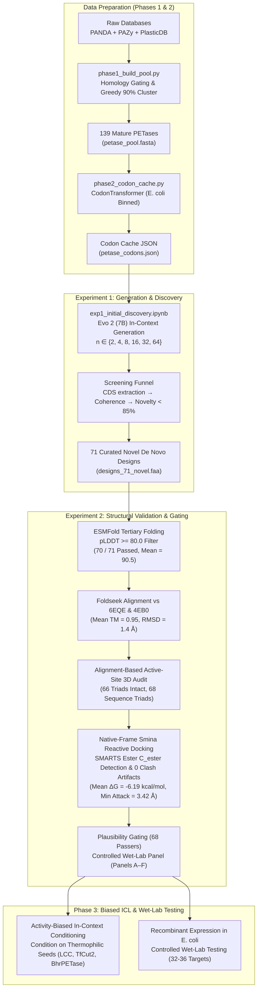

# Experiments Suite: De Novo PETase Design via Genomic In-Context Learning

This directory houses the experimental campaigns for designing and validating **de novo plastic-degrading enzymes (PET hydrolases)** using the nucleotide autoregressive foundation model **Evo 2 (7B)**.

---

## Navigation & Quick Links
- **[Main Project README (`../README.md`)](../README.md)**
- **[Experiment 1: In-Context Learning & Generation (`experiment1_initial_tests/README.md`)](experiment1_initial_tests/README.md)**
- **[Experiment 2: Structural Validation & Active-Site Architecture (`experiment_2_folding/README.md`)](experiment_2_folding/README.md)**

---

## Experimental Progression



---

## Directory Index & Experiment Summaries

### [1. Experiment 1: In-Context Learning for De Novo PETase Generation](experiment1_initial_tests/README.md)
- **Path:** [`experiments/experiment1_initial_tests/`](experiment1_initial_tests/)
- **Notebook:** [`exp1_initial_discovery.ipynb`](experiment1_initial_tests/exp1_initial_discovery.ipynb)
- **Focus:** Demonstrating that in-context learning with nucleotide foundation models (Evo 2 7B) generates functional enzyme coding sequences without explicit structural backbones or fine-tuning.
- **Key Protocol:**
  - Evaluated context depths $n \in \{2, 4, 8, 16, 32, 64\}$ across 10 independent prompt draws and 4 samples per prompt (240 total generated sequences).
  - Built a 4-stage automated screening funnel: CDS parsing $\rightarrow$ mature length window (241–306 aa) $\rightarrow$ family coherence (MMseqs2 $E < 0.01$) $\rightarrow$ sequence novelty ($< 85.0\%$ max identity to training pool).
- **Core Results:**
  - Novel coherent yield scaled monotonically from **0.0% at $n=2$** to **65.0% at $n=64$**.
  - Curated **71 novel de novo PETase designs** ([`designs_71_novel.faa`](experiment1_initial_tests/designs_71_novel.faa)).

---

### [2. Experiment 2: Structural Validation, Active-Site Architecture & Multi-Parametric Ranking](experiment_2_folding/README.md)
- **Path:** [`experiments/experiment_2_folding/`](experiment_2_folding/)
- **Notebook:** [`exp2_structural_validation_and_biased_icl.ipynb`](experiment_2_folding/exp2_structural_validation_and_biased_icl.ipynb)
- **Scripts:** [`run_structural_validation_v2.py`](experiment_2_folding/run_structural_validation_v2.py) & [`rank_v2.py`](experiment_2_folding/rank_v2.py)
- **Focus:** Multi-tiered atomic-resolution validation of the 71 curated designs from Experiment 1 to evaluate foldability, active-site integrity, and substrate binding.
- **Key Results from Audited Pipeline:**
  - **70 / 71 designs (98.6%)** adopted high-confidence globular folds ($\text{mean pLDDT} = 90.5$).
  - **66 / 70 designs (94.3%)** formed pristine catalytic triads within operative hydrogen-bonding distances, while **68 / 70 (97.1%)** possess intact sequence triads.
  - **0 clash artifacts (< 2.2 Å):** Capture of native coordinates before superposition eliminated all previous coordinate-frame clash bugs.
  - Smina reactive docking against **2-HE(MHET)** achieved binding affinities down to **$-7.20\text{ kcal/mol}$** (mean: **$-6.19\text{ kcal/mol}$**) and clean physical attack distances ($3.42\text{ \AA} - 9.84\text{ \AA}$).
  - Standout Candidates:
    - **`petase_64_seq_34` (Overall Champion):** Top rank (0.7087) with 94.0 pLDDT, 0.9602 TM-score, pristine catalytic triad (2.85 Å / 2.86 Å), strong binding affinity ($-6.0\text{ kcal/mol}$), physical attack distance of **$3.76\text{ \AA}$**, and extreme sequence novelty (**60.9% identity** — over 100 mutations from the nearest known PETase).
    - **`petase_32_seq_21`:** Tightest physical attack approach at **$3.42\text{ \AA}$**, $\Delta G = -6.1\text{ kcal/mol}$, and 55.7% sequence identity.
    - **`petase_16_seq_11`:** Structural purity champion with **95.0 pLDDT**, 0.9660 TM-score, and sub-angstrom triad (2.88 Å / 2.86 Å).
  - Selected a **controlled wet-lab testing panel** ([`results/wetlab_panel_v2.tsv`](experiment_2_folding/results/wetlab_panel_v2.tsv)) balancing structure leads, diverse sequences, random controls, rescued designs, knockouts, and natural benchmarks.

---

## Cross-Experiment Comparison & Summary

| Parameter | Phase 1 (Data Prep) | Experiment 1 (Discovery) | Experiment 2 (Validation & Gating) |
| :--- | :--- | :--- | :--- |
| **Input Sequences** | 3 databases (PANDA, PAZy, PlasticDB) | 139 non-redundant mature PETases | 71 novel de novo designs |
| **Primary Method** | Homology gating & CodonTransformer | Evo 2 (7B) in-context autoregression | ESMFold + Foldseek + Pairwise Alignment Audit + Native Smina Docking |
| **Output Library** | `petase_pool.fasta` & `petase_codons.json` | 71 novel designs (`designs_71_novel.faa`)| Ranked Table (70 docked PDBQTs) & Controlled Wet-Lab Panel |
| **Key Metric** | Identity $\le 90\%$, Coverage $\ge 70\%$ | Yield vs context depth ($0\% \rightarrow 65\%$) | 66 Intact Triads (94.3%), 0 Clash Artifacts, Mean $\Delta G = -6.19\text{ kcal/mol}$ |
| **Status** | Completed | Completed | Completed & Validated |

---

## Reproducing the Experiments

### 1. Environment Setup
```bash
pip install -r requirements.txt
pip install torch transformers accelerate biopython rdkit pandas numpy matplotlib
```

### 2. Execution Order
1. **Pool Curation:**
   ```bash
   python phase1_build_pool.py --panda data/panda.xlsx --pazy data/pazy_proteins.fasta --plasticdb data/PlasticDB.fasta
   ```
2. **Codon Caching:**
   ```bash
   python phase2_codon_cache.py
   ```
3. **Experiment 1 (Generation):** Run [`experiments/experiment1_initial_tests/exp1_initial_discovery.ipynb`](experiment1_initial_tests/exp1_initial_discovery.ipynb).
4. **Experiment 2 (Structural Validation & Gating):**
   ```bash
   # Run structural validation and native-frame Smina reactive docking:
   python experiments/experiment_2_folding/run_structural_validation_v2.py \
       --fasta experiments/experiment1_initial_tests/designs_71_novel.faa \
       --out experiments/experiment_2_folding/results \
       --device cuda

   # Generate the controlled wet-lab panel:
   python experiments/experiment_2_folding/rank_v2.py . experiments/experiment_2_folding/results
   ```
   Or execute [`experiments/experiment_2_folding/exp2_structural_validation_and_biased_icl.ipynb`](experiment_2_folding/exp2_structural_validation_and_biased_icl.ipynb).
