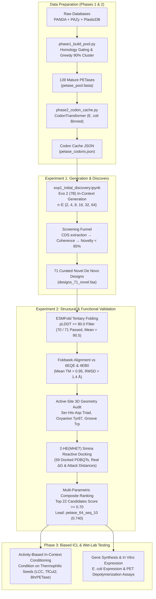

# Experiments Suite: De Novo PETase Design via Genomic In-Context Learning

This directory houses the experimental campaigns for designing and validating **de novo plastic-degrading enzymes (PET hydrolases)** using the nucleotide autoregressive foundation model **Evo 2 (7B)**.

---

## Navigation & Quick Links
- **[Main Project README (`../README.md`)](../README.md)**
- **[Experiment 1: In-Context Learning & Generation (`experiment1_initial_tests/README.md`)](experiment1_initial_tests/README.md)**
- **[Experiment 2: Structural Validation & Active-Site Architecture (`experiment_2_folding/README.md`)](experiment_2_folding/README.md)**

---

## Experimental Progression



---

## Directory Index & Experiment Summaries

### [1. Experiment 1: In-Context Learning for De Novo PETase Generation](experiment1_initial_tests/README.md)
- **Path:** [`experiments/experiment1_initial_tests/`](experiment1_initial_tests/)
- **Notebook:** [`exp1_initial_discovery.ipynb`](experiment1_initial_tests/exp1_initial_discovery.ipynb)
- **Focus:** Demonstrating that in-context learning with nucleotide foundation models (Evo 2 7B) generates functional enzyme coding sequences without explicit structural backbones or fine-tuning.
- **Key Protocol:**
  - Evaluated context depths $n \in \{2, 4, 8, 16, 32, 64\}$ across 10 independent prompt draws and 4 samples per prompt (240 total generated sequences).
  - Built a 4-stage automated screening funnel: CDS parsing $\rightarrow$ mature length window (241–306 aa) $\rightarrow$ family coherence (MMseqs2 $E < 0.01$) $\rightarrow$ sequence novelty ($< 85.0\%$ max identity to training pool).
- **Core Results:**
  - Novel coherent yield scaled monotonically from **0.0% at $n=2$** to **65.0% at $n=64$**.
  - Curated **71 novel de novo PETase designs** ([`designs_71_novel.faa`](experiment1_initial_tests/designs_71_novel.faa)).

---

### [2. Experiment 2: Structural Validation, Active-Site Architecture & Multi-Parametric Ranking](experiment_2_folding/README.md)
- **Path:** [`experiments/experiment_2_folding/`](experiment_2_folding/)
- **Notebook:** [`exp2_structural_validation_and_biased_icl.ipynb`](experiment_2_folding/exp2_structural_validation_and_biased_icl.ipynb)
- **Script:** [`run_structural_validation.py`](experiment_2_folding/run_structural_validation.py)
- **Focus:** Multi-tiered atomic-resolution validation of the 71 curated designs from Experiment 1 to evaluate foldability, active-site integrity, and substrate binding.
- **Key Protocol:**
  - **Tier 1:** Catalytic sequence motif gate (`[GWA]-x-[SMG]-x-G`).
  - **Tier 2:** High-throughput 3D folding with **ESMFold** ($\text{pLDDT} \ge 80.0$).
  - **Tier 3:** Topological alignment against **IsPETase (`6EQE`)** and **LCC (`4EB0`)** with **Foldseek**.
  - **Tier 4:** Sub-angstrom spatial auditing of the catalytic triad (**Ser160–His237–Asp206**), oxyanion hole (**Tyr87**), and aromatic groove (**Trp159/Trp185**).
  - **Tier 5:** Smina reactive docking against **2-HE(MHET)** (`results/docking_ligands/2he_mhet.pdbqt`), generating 59 docked complex files (`results/docking_results/*.pdbqt`).
  - **Composite Ranking:** Multi-parametric functional fitness scoring.
- **Core Results:**
  - **70 / 71 designs (98.6%)** adopted high-confidence globular folds ($\text{mean pLDDT} = 90.5$).
  - **56 / 70 designs (80.0%)** formed an intact catalytic triad within operative hydrogen-bonding distances.
  - **59 designs** successfully docked with Smina, yielding binding affinities down to $-5.8\text{ kcal/mol}$ and nucleophilic attack distances down to $1.64\text{ \AA}$.
  - **22 candidates** surpassed the high-performance threshold $\text{Score} \ge 0.70$.
  - Standout candidates identified:
    - **`petase_64_seq_10`** (New overall lead, score: 0.740, pLDDT: 93.0, attack dist: 1.80 Å, Ser–His: 2.94 Å, His–Asp: 2.84 Å).
    - **`petase_64_seq_34`** (Extreme novelty champion, score: 0.738, **60.9% identity**, attack dist: 3.29 Å, Ser–His: 2.85 Å).
    - **`petase_32_seq_8`** (Energetic lead, score: 0.734, $\Delta G = -5.2\text{ kcal/mol}$, attack dist: 2.59 Å).
  - Established Phase 3 methodology: Statistical scaling ($N\_PROMPTS = 25$) and activity-biased in-context conditioning on thermophilic PETases.

---

## Cross-Experiment Comparison & Summary

| Parameter | Phase 1 (Data Prep) | Experiment 1 (Discovery) | Experiment 2 (Validation) |
| :--- | :--- | :--- | :--- |
| **Input Sequences** | 3 databases (PANDA, PAZy, PlasticDB) | 139 non-redundant mature PETases | 71 novel de novo designs |
| **Primary Method** | Homology gating & CodonTransformer | Evo 2 (7B) in-context autoregression | ESMFold + Foldseek + 3D active site audit + Smina Docking |
| **Output Library** | `petase_pool.fasta` & `petase_codons.json` | 71 novel designs (`designs_71_novel.faa`)| 22 top-ranked candidates ($\text{score} \ge 0.70$) & 59 docked PDBQTs |
| **Key Metric** | Identity $\le 90\%$, Coverage $\ge 70\%$ | Yield vs context depth ($0\% \rightarrow 65\%$) | pLDDT ($90.5$), Triad intact ($80.0\%$), 59 Docked Poses |
| **Status** | Completed | Completed | Completed |

---

## Reproducing the Experiments

### 1. Environment Setup
Create a dedicated environment with Python 3.12/3.14 and install required packages:
```bash
pip install -r requirements.txt
pip install torch transformers accelerate biopython rdkit pandas numpy matplotlib
```

### 2. Execution Order
1. **Pool Curation:**
   ```bash
   python phase1_build_pool.py --panda data/panda.xlsx --pazy data/pazy_proteins.fasta --plasticdb data/PlasticDB.fasta
   ```
2. **Codon Caching:**
   ```bash
   python phase2_codon_cache.py
   ```
3. **Experiment 1 (Generation):** Run [`experiments/experiment1_initial_tests/exp1_initial_discovery.ipynb`](experiment1_initial_tests/exp1_initial_discovery.ipynb).
4. **Experiment 2 (Structural Validation):**
   ```bash
   python experiments/experiment_2_folding/run_structural_validation.py \
       --fasta experiments/experiment1_initial_tests/designs_71_novel.faa \
       --out experiments/experiment_2_folding/results \
       --device cuda
   ```
   Or interactively execute [`experiments/experiment_2_folding/exp2_structural_validation_and_biased_icl.ipynb`](experiment_2_folding/exp2_structural_validation_and_biased_icl.ipynb).
