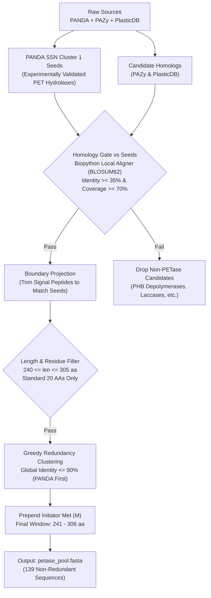
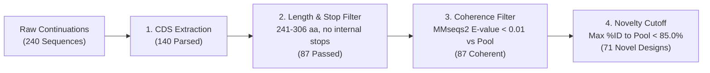

# Experiment 1: In-Context Learning for De Novo PETase Generation

This document outlines the end-to-end experimental protocol for **Experiment 1 (Initial Discovery)**: from building the non-redundant PETase sequence pool and codon-optimizing DNA prompts to executing in-context generation with **Evo 2 (7B)** and curating the **71 novel de novo PETase designs**.

---

## 1. Experimental Overview & Objectives

In-context learning (ICL) with nucleotide autoregressive foundation models allows de novo protein design without fine-tuning, structural backbones, or explicit optimization passes. By presenting the model with multiple natural coding sequences from a target family separated by synthetic spacers, the continuation completes a novel coding sequence.

```
[Prompt Layout]
GGGGGGGG <CDS_1> GGGGGGGG <CDS_2> ... GGGGGGGG <CDS_N> GGGGGGGG <Continuation>
```

This experiment evaluated how the **number of in-context examples ($n$)** governs the **yield**, **coherence**, and **novelty** of generated PETase enzymes across context depths:
$$n \in \{2, 4, 8, 16, 32, 64\}$$

---

## 2. Phase 1: Curating the PETase Training Pool (`phase1_build_pool.py`)

The training pool was built by harmonizing three distinct plastic-degrading enzyme databases:
1. **PANDA Dataset (`data/panda.xlsx`):** A systematic review of sequence, structure, and functional data for PET hydrolases (*Proteins*, 2024, pro.70282).
2. **PAZy (`data/pazy_proteins.fasta`):** Plastics-Active Enzymes Database.
3. **PlasticDB (`data/PlasticDB.fasta`):** Repository of plastic-degrading microorganisms and enzymes.

### Filtering Pipeline & Logic


1. **Seeds Selection:** Unique sequences classified in PANDA Sequence Similarity Network (SSN) **"Cluster 1"** (bona fide, experimentally validated PET hydrolases with signal peptides previously excised).
2. **Homology Gating:** Candidates from PAZy and PlasticDB were aligned to all seeds using a pairwise local aligner (BLOSUM62 matrix, gap open $-11$, gap extend $-1$). A candidate was retained only if:
   - Pairwise sequence identity $\ge 35\%$ (`MIN_ID = 0.35`)
   - Query alignment coverage $\ge 70\%$ of seed length (`MIN_COV = 0.70`)
   - *Rationale:* Reject unrelated esterases, cutinases lacking PET activity, and false positives.
3. **Signal Peptide Trimming:** Seed start and end coordinates were projected onto the candidate sequence, eliminating N-terminal signal peptides while keeping the mature catalytic core.
4. **Length & Sequence Hygiene:** Filtered for mature lengths between 240 and 305 amino acids containing standard amino acids only.
5. **Redundancy Reduction (Greedy 90% Cut):** Sequences were clustered such that no sequence shared $> 90\%$ global pairwise identity (`MAX_ID = 0.90`) to any sequence already accepted. PANDA validated seeds were processed first to preserve known experimentally characterized enzymes.
6. **Prepend Start Met:** Added an initial Methionine (`M`) to each mature sequence.
- **Output Files:**
  - `prepared_data/three_datasets_16nov2026/petase_pool.fasta` (139 non-redundant sequences, lengths 241–306 aa)
  - `prepared_data/three_datasets_16nov2026/petase_pool_report.tsv` (full audit log of kept/dropped candidates)

---

## 3. Phase 2: Protein-to-DNA Codon Cache (`phase2_codon_cache.py`)

Because Evo 2 is a genomic nucleotide foundation model, prompts must be presented as DNA sequences rather than amino acids. Rather than using arbitrary or uniform back-translation, sequences were optimized for high-level bacterial expression.

### Optimization Specifications
- **Tool:** **CodonTransformer** (deep bidirectional transformer for species-specific codon optimization).
- **Host Organism:** *Escherichia coli general* (`ORGANISM = "Escherichia coli general"`).
- **Termination Codon:** Appended `TGA` to every translated open reading frame.
- **Verification:** Forward translation in silico was asserted to match 100% of the input protein sequence.
- **Output File:**
  - `prepared_data/three_datasets_16nov2026/petase_codons.json` containing the schema:
    `{ "family": "petase", "organism": "Escherichia coli general", "proteins": [...], "dna": [...] }`

---

## 4. Phase 3: Generation via In-Context Learning (`exp1_initial_discovery.ipynb`)

Generation was executed using `evo2_flash` in a Python 3.12 environment with **vLLM 0.26.0** on an NVIDIA GPU (L4 / A100 with 24 GB VRAM).

### Hyperparameters & Prompt Construction
- **Model:** `evo2_7b`
- **Decoding Configuration:**
  - Temperature: $T = 0.8$
  - Top-$k$: $k = 4$
  - Top-$p$: $1.0$ (disabled)
  - Seed: `1337` (draw $p$ uses $\text{seed} + p$)
  - Spacer: `GGGGGGGG` (8 bp poly-G separator)
  - Generated continuation length: 950 nucleotides
- **Grid Sweep:**
  - In-context example counts: $n \in \{2, 4, 8, 16, 32, 64\}$
  - $N\_PROMPTS = 10$ independent draws per cell
  - $SAMPLES\_PER\_PROMPT = 4$ parallel continuations per prompt
  - Total generation budget: $6 \text{ cells} \times 10 \text{ draws} \times 4 \text{ samples} = 240 \text{ sequences}$
- **Prompt Structure:**
  ```python
  def compose_prompt(dna_seqs, spacer="GGGGGGGG"):
      return "".join(spacer + s for s in dna_seqs) + spacer
  ```
  At $n=64$, the prompt prefill reaches $\approx 53\text{ kb}$ of DNA, representing full utilization of long-context in-context learning.

---

## 5. Phase 4: Screening Funnel & Curating the 71 Novel Designs

The 240 continuations were translated and evaluated through an automated 4-stage funnel:



### Funnel Criteria
1. **CDS Extraction (`parsed`):** The model must emit a closing spacer `GGGGGGGG` (or stop codon) within the 950 nt generation window, allowing precise extraction of the coding sequence.
2. **Length & Termination (`in_window`):** The translated sequence must fall within the natural mature length bounds of the pool ($241 \le \text{len} \le 306$ aa) with no internal premature stops.
3. **Family Coherence (`coherent`):** Evaluated by `mmseqs easy-search` against `petase_pool.fasta` with significance threshold $E < 0.01$. Confirms the continuation is a true member of the PETase family.
4. **Novelty (`novel`):** Maximum sequence identity against any sequence in the 139-member training pool must be strictly below 85.0% (`best_id < 85.0`). Sequences exceeding $85\%$ are considered memorized copies.

### Experimental Yield Funnel by In-Context Size ($n$)

| Context Size ($n$) | Samples | Parsed CDS | In Window | Coherent ($E < 0.01$) | **Novel Kept ($< 85\%$ ID)** | Novel Yield (Mean $\pm$ SEM) | Kept % |
| :---: | :---: | :---: | :---: | :---: | :---: | :---: | :---: |
| **$n = 2$** | 40 | 7 | 4 | 4 | **0** | $0.0\% \pm 0.0\%$ | 0.0% |
| **$n = 4$** | 40 | 14 | 7 | 7 | **1** | $2.5\% \pm 2.5\%$ | 14.3% |
| **$n = 8$** | 40 | 19 | 9 | 9 | **7** | $17.5\% \pm 3.8\%$ | 77.8% |
| **$n = 16$** | 40 | 30 | 16 | 16 | **15** | $37.5\% \pm 9.3\%$ | 93.8% |
| **$n = 32$** | 40 | 34 | 24 | 24 | **22** | $55.0\% \pm 8.2\%$ | 91.7% |
| **$n = 64$** | 40 | 36 | 27 | 27 | **26** | $65.0\% \pm 8.5\%$ | 96.3% |
| **Total** | **240** | **140** | **87** | **87** | **71** | — | — |

*Key Finding:* Novel and coherent yield scales directly with in-context depth ($0\%$ at $n=2 \rightarrow 65\%$ at $n=64$).

---

## 6. Output Files & Dataset Manifest

All artifacts from this experiment are organized as follows:

| File Name | Description |
| :--- | :--- |
| **[`designs_71_novel.faa`](designs_71_novel.faa)** | The 71 curated novel de novo PETase designs (FASTA with metadata headers and stripped terminal `*`). |
| **`petase_002.faa` – `petase_064.faa`** | Translated protein sequences for each $n$ grid cell. |
| **`petase_002.m8` – `petase_064.m8`** | MMseqs2 alignment tables against the 139-member baseline training pool. |
| **`gen_petase_002.json` – `gen_petase_064.json`** | Raw nucleotide continuations generated by Evo 2. |
| **[`novel_yield_T0.8.tsv`](novel_yield_T0.8.tsv)** | Tabular summary of mean yield, novel yield, SEM, and retention percentage across $n$. |
| **`novel_yield_T0.8.png` / `.svg`** | Yield curves showing novel + coherent recovery as a function of in-context examples. |
| **[`exp1_initial_discovery.ipynb`](exp1_initial_discovery.ipynb)** | Full executable Jupyter notebook running prompt building, generation, search, and plotting. |

---

## 7. Next Phase: Downstream Validation

The 71 candidate enzymes curated here represent sequence-coherent candidates. Downstream biophysical verification is conducted in **Experiment 2**:
1. **Tertiary Foldability:** High-throughput folding using **ESMFold** with confidence filtering ($\text{mean pLDDT} \ge 80.0$).
2. **Fold Topology:** Structural alignment against wild-type **IsPETase** (`6EQE`) and **LCC** (`4EB0`) via **Foldseek**.
3. **Catalytic Geometry:** 3D sub-angstrom distance validation of the catalytic triad (**Ser160–His237–Asp206**).
