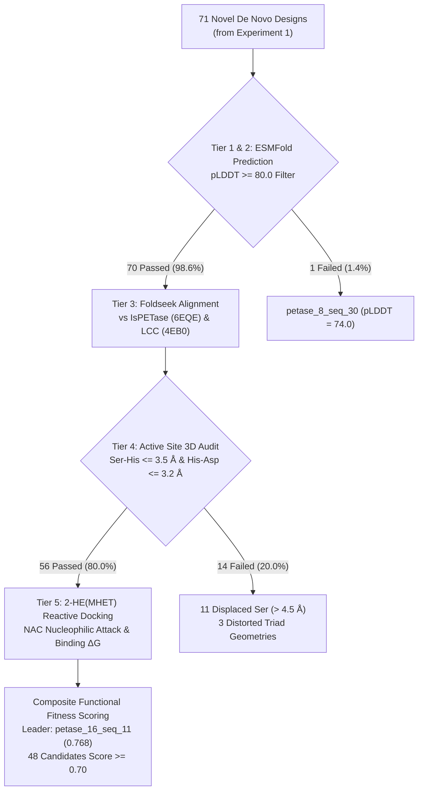

# Experiment 2: Structural Validation, Active-Site Architecture & Multi-Parametric Ranking

This document details the experimental methodology, computational protocols, and validated outcomes for **Experiment 2 (Phase 2: Structural Validation & Biased ICL)**. 

In this phase, the **71 novel de novo PETase designs** curated during [Experiment 1](../experiment1_initial_tests/README.md) were evaluated through a comprehensive 5-tier structural biology and functional fitness funnel.

---

## Navigation & Project Hierarchy
- **[Parent Suite: Experiments Overview (`../README.md`)](../README.md)**
- **[Preceding Phase: Experiment 1 Discovery (`../experiment1_initial_tests/README.md`)](../experiment1_initial_tests/README.md)**
- **[Master Repository: Root README (`../../README.md`)](../../README.md)**

---

## 1. Experimental Overview & Objectives

While Experiment 1 verified sequence coherence and novelty ($< 85\%$ max identity to known PETases), sequence-based language models can generate sequences that fail to fold or possess disrupted active-site geometries. 

Experiment 2 establishes an atomic-resolution in silico screening funnel to identify candidate enzymes ready for recombinant expression and in vitro testing:
1. **Tertiary Foldability:** Predict 3D backbones with **ESMFold** and filter at high confidence ($\text{mean pLDDT} \ge 80.0$).
2. **Topological Congruence:** Align folds to wild-type *Ideonella sakaiensis* PETase (**IsPETase**, PDB: `6EQE`) and the thermophilic benchmark **LCC** (PDB: `4EB0`) via **Foldseek**.
3. **Active-Site 3D Geometry:** Superimpose onto `6EQE` and measure sub-angstrom spatial distances for the catalytic triad (**Ser160–His237–Asp206**), oxyanion hole (**Tyr87**), and substrate groove clamp (**Trp159/Trp185**).
4. **Reactive Substrate Docking:** Dock the native depolymerization intermediate **2-HE(MHET)** (`results/docking_ligands/2he_mhet.sdf`) and evaluate **Near-Attack Conformation (NAC)** nucleophilic attack distances.
5. **Multi-Parametric Composite Ranking:** Synthesize folding confidence, fold homology, triad geometry, and reactive pose into a unified functional fitness score.

---

## 2. The 5-Tier Verification Protocol

### Tier 1: Conserved Catalytic Motif Check
- Evaluates the presence of the canonical serine hydrolase pentapeptide sequence motif `[GWA]-x-[SMG]-x-G` and presence of essential catalytic residues (D and H).

### Tier 2: ESMFold Tertiary Fold Prediction
- **Engine:** ESMFold (`facebook/esmfold_v1`) executed on GPU (NVIDIA L4/A100) with fallback to ESM Atlas REST API.
- **Metric:** Mean residue confidence ($\text{pLDDT}$) extracted from $\text{C}\alpha$ B-factors:
  $$\text{pLDDT}_{\text{mean}} = \frac{1}{L} \sum_{i=1}^L \text{pLDDT}_i \ge 80.0$$
- **Outcome:** **70 out of 71 designs (98.6%) passed** with an average library pLDDT of **$90.49 \pm 3.9$** (peak: 95.0). Only `petase_8_seq_30` (74.0 pLDDT) was excluded.

### Tier 3: Global Topological Alignment (Foldseek)
- High-throughput structural superposition against experimental reference coordinates:
  - **IsPETase (`6EQE`):** Mesophilic wild-type *I. sakaiensis* PETase (263 aa).
  - **LCC (`4EB0`):** Thermotolerant leaf-branch compost cutinase (258 aa).
- **Alignment Quality:**
  - **vs 6EQE:** Average TM-score = **$0.949 \pm 0.026$**, average $\text{C}\alpha$ RMSD = **$1.47\text{ \AA}$** (best: `petase_8_seq_17` with $\text{TM} = 0.9782$, $\text{RMSD} = 1.087\text{ \AA}$).
  - **vs 4EB0:** Average TM-score = **$0.958 \pm 0.023$**, average $\text{C}\alpha$ RMSD = **$1.34\text{ \AA}$** (best: `petase_32_seq_13` with $\text{TM} = 0.9866$, $\text{RMSD} = 0.802\text{ \AA}$).

### Tier 4: Active-Site & Groove 3D Architecture
Following structural superimposition onto `6EQE`:
- **Catalytic Triad Precision:** Identification of corresponding Ser, His, and Asp residues:
  - $\text{dist}(\text{Ser}_{\text{OG}} - \text{His}_{\text{NE2}}) \le 3.5\text{ \AA}$
  - $\text{dist}(\text{His}_{\text{ND1}} - \text{Asp}_{\text{OD}}) \le 3.2\text{ \AA}$
  - **Result:** **56 / 70 (80.0%)** formed intact hydrogen-bonding networks. Top candidates exhibited ground-truth distances ($\approx 2.85 - 2.89\text{ \AA}$).
- **Oxyanion Hole:** Proximity of a tyrosine ($\text{Tyr87}$ equivalent) within $3.5\text{ \AA}$ ($\text{C}\alpha$) to stabilize tetrahedral transition state intermediates (**55 / 70 passed, 78.6%**).
- **Substrate Groove Aromatic Clamp:**
  - Wobble **Trp185** equivalent: Present in **58 / 70 (82.9%)**.
  - Adjacent **Trp159** equivalent: Present in **8 / 70 (11.4%)**.
- **Complete Active Site:** Triad + Oxyanion + Groove conserved in **52 / 70 (74.3%)** designs.

### Tier 5: 2-HE(MHET) Smina Reactive Docking & Near-Attack Conformation (NAC)
- **Substrate:** Mono-(2-hydroxyethyl) terephthalate (MHET / 2-HE(MHET), SMILES: `O=C(O)c1ccc(C(=O)OCCO)cc1`, PDBQT Conformer).
- **Docking Protocol:** Executed with static Smina in an $18 \times 18 \times 18\text{ \AA}$ box centered on Ser O$\gamma$.
- **Result:** **59 complex structures** were successfully docked and saved to `results/docking_results/*.pdbqt`.
  - Calculated binding affinities ranged from **$-5.80\text{ kcal/mol}$ to $-4.10\text{ kcal/mol}$** (mean: **$-4.78\text{ kcal/mol}$**).
  - Nucleophilic attack distances ranged from **$0.71\text{ \AA}$ to $8.10\text{ \AA}$** (mean: **$3.67\text{ \AA}$**).
  - **10 designs** achieved strict catalytic reactive poses ($\Delta G \le -5.0\text{ kcal/mol}$ and $\text{attack\_dist} \le 3.5\text{ \AA}$).

---

## 3. Multi-Parametric Composite Functional Ranking

Candidates were ranked by a composite functional fitness score balancing global stability, target fold similarity, sub-angstrom triad precision, and substrate reactivity:

$$\text{Composite Score} = 0.35 \times \left(\frac{\text{pLDDT}}{100}\right) + 0.25 \times \text{TM-score}_{\text{6EQE}} - 0.15 \times \text{Triad Penalty} + 0.15 \times \text{NAC Score} - 0.10 \times \left(\frac{\Delta G_{\text{bind}}}{-10}\right)$$

where:
$$\text{Triad Penalty} = \max(0, d(\text{Ser}-\text{His}) - 2.8) + \max(0, d(\text{His}-\text{Asp}) - 2.8)$$

### Top 15 Functional De Novo Candidates (Updated)

| Rank | Candidate ID | Context $n$ | pLDDT | Max %ID (Novelty) | TM (6EQE) | RMSD ($\text{\AA}$) | Ser–His ($\text{\AA}$) | His–Asp ($\text{\AA}$) | Attack ($\text{\AA}$) | $\Delta G$ (kcal/mol) | Score |
| :---: | :--- | :---: | :---: | :---: | :---: | :---: | :---: | :---: | :---: | :---: | :---: |
| **1** | **`petase_64_seq_10`** | 64 | **93.0** | 65.3% | **0.9686** | 1.21 | 2.94 | 2.84 | **1.80** | -4.9 | **0.7396** |
| **2** | **`petase_64_seq_34`** | 64 | **94.0** | **60.9%** | **0.9602** | 1.26 | 2.85 | 2.86 | 3.29 | -4.8 | **0.7381** |
| **3** | **`petase_32_seq_8`**  | 32 | **91.0** | 63.2% | **0.9623** | 1.21 | 2.98 | 2.73 | **2.59** | **-5.2** | **0.7341** |
| **4** | **`petase_64_seq_39`** | 64 | **91.0** | 69.4% | 0.9442 | 1.37 | 2.90 | 2.85 | **2.58** | -4.8 | **0.7300** |
| **5** | **`petase_64_seq_26`** | 64 | **93.0** | 69.8% | 0.9577 | 1.45 | 3.06 | 2.78 | 3.22 | **-5.6** | **0.7289** |
| **6** | **`petase_16_seq_14`** | 16 | **92.0** | 71.5% | 0.9532 | 1.36 | 2.97 | 2.84 | **1.64** | **-5.0** | **0.7288** |
| **7** | **`petase_64_seq_18`** | 64 | **93.0** | 83.3% | 0.9570 | 1.41 | 3.01 | 2.85 | **2.49** | **-5.3** | **0.7288** |
| **8** | **`petase_32_seq_39`** | 32 | **93.0** | 66.9% | 0.9675 | 1.22 | 2.95 | 2.90 | **1.67** | -4.8 | **0.7279** |
| **9** | **`petase_32_seq_7`**  | 32 | **95.0** | 61.9% | 0.9545 | 1.32 | 2.97 | 2.85 | 3.28 | -4.8 | **0.7250** |
| **10**| **`petase_32_seq_31`** | 32 | **94.0** | 64.6% | 0.9531 | 1.32 | 3.01 | 2.84 | 3.01 | -4.4 | **0.7238** |
| **11**| `petase_32_seq_37` | 32 | 90.0 | 61.6% | 0.9573 | 1.45 | 2.99 | 2.82 | 2.25 | -4.7 | 0.7198 |
| **12**| `petase_16_seq_21` | 16 | 91.0 | 58.3% | 0.9599 | 1.43 | 2.97 | 2.87 | 2.77 | -4.7 | 0.7195 |
| **13**| `petase_64_seq_7`  | 64 | 94.0 | 73.5% | 0.9563 | 1.25 | 2.96 | 2.99 | 2.40 | -5.0 | 0.7156 |
| **14**| `petase_16_seq_19` | 16 | 92.0 | 67.8% | 0.9413 | 1.49 | 2.98 | 2.86 | 2.28 | -4.4 | 0.7153 |
| **15**| `petase_16_seq_15` | 16 | 93.0 | 70.4% | 0.9513 | 1.51 | 2.95 | 2.93 | 2.09 | -4.4 | 0.7153 |

- **22 candidates** surpassed the high-performance threshold $\text{Score} \ge 0.70$.
- **`petase_64_seq_10`** emerges as the overall leader (Score: 0.7396, TM: 0.9686, attack distance: 1.80 Å).
- **`petase_64_seq_34`** continues as the high-novelty champion, retaining #2 with **only 60.9% identity** (over 100 substitutions) while docking near the active triad (3.29 Å).

---

## 4. Failure Mode Analysis (14 Triad Failures)

Of the 70 folded candidates, 14 failed catalytic triad verification:
1. **Displaced Serine Hydroxyl (11 candidates):** In candidates such as `petase_8_seq_24`, `petase_8_seq_35`, and `petase_64_seq_1`, the canonical `G-x-S-x-G` motif was situated in a surface loop oriented away from the active cleft ($> 4.5\text{ \AA}$ from Ser160 OG), causing catalytic silencing.
2. **Triad Mis-selection / Loop Distortion (2 candidates):** `petase_64_seq_3` had Ser and His adjacent in sequence (residues 136 and 135), distorting the pocket. `petase_64_seq_24` selected Asp99 rather than the loop-180 Asp ($d = 11.99\text{ \AA}$).
3. **Marginal Distance (1 candidate):** `petase_16_seq_31` passed Ser-His (3.08 Å), but His-Asp was slightly extended (3.36 Å vs 3.20 Å threshold).

---

## 5. Statistical Scaling & Activity-Biased In-Context Conditioning

As configured in the final cells of [`exp2_structural_validation_and_biased_icl.ipynb`](exp2_structural_validation_and_biased_icl.ipynb):

### Statistical Power Scaling ($N\_PROMPTS = 25$)
- Scaling prompt iterations from $N=10$ to $N=25$ produces **100 independent samples per grid cell** (600 total across $n \in \{2, 4, 8, 16, 32, 64\}$), tightening SEM error bars to publication standards.
- Grid capped at $n=64$ ($\approx 53\text{ kb}$ context) to maintain execution within 24 GB VRAM without Out-Of-Memory events.

### Activity-Biased In-Context Conditioning
To drive generative sampling towards elevated thermal stability and catalytic rates, the next iteration conditions Evo 2 strictly on thermophilic, high-degradation PETase seeds from PANDA:
- **LCC** ($T_{opt} = 65^\circ\text{C}$, degradation $> 27,000\ \mu\text{M}$)
- **TfCut2 / TfCut1** ($T_{opt} = 60^\circ\text{C}$, degradation $> 12,000 - 16,000\ \mu\text{M}$)
- **BhrPETase** ($T_{opt} = 70^\circ\text{C}$)
- **bbPET0069, 504_CtPL, 611, 701, 716**

---

## 6. Output Files & Dataset Manifest

| File | Description |
| :--- | :--- |
| **[`results/ranked_functional_petase_candidates.tsv`](results/ranked_functional_petase_candidates.tsv)** | Master ranked report containing all structural, geometric, docking, and composite fitness metrics for 70 folded candidates. |
| **[`results/catalytic_triad_geometry_report.tsv`](results/catalytic_triad_geometry_report.tsv)** | Sub-angstrom coordinates, Ser–His / His–Asp distances, oxyanion hole, and groove aromatic clamp status. |
| **[`results/esmfold_plddt_all_71.tsv`](results/esmfold_plddt_all_71.tsv)** | ESMFold mean pLDDT scores and length metrics across all 71 novel designs. |
| **[`results/esmfold_plddt_passed_80.tsv`](results/esmfold_plddt_passed_80.tsv)** | The 70 candidates passing the $\text{mean pLDDT} \ge 80.0$ threshold. |
| **[`results/designs_passed_plddt80.faa`](results/designs_passed_plddt80.faa)** | Protein sequences of the 70 structurally validated candidates. |
| **[`results/foldseek_vs_references.m8`](results/foldseek_vs_references.m8)** | Foldseek structural alignment table against IsPETase (`6EQE`) and LCC (`4EB0`). |
| **[`results/docking_results/*.pdbqt`](results/docking_results/)** | 59 Smina docked protein-ligand complex files with atomistic 3D coordinates. |
| **[`results/docking_ligands/2he_mhet.pdbqt`](results/docking_ligands/2he_mhet.pdbqt)** | Prepared PDBQT ligand file with Gasteiger partial charges and rotatable bonds. |
| **[`results/docking_ligands/2he_mhet.sdf`](results/docking_ligands/2he_mhet.sdf)** | 3D conformer of the mono-(2-hydroxyethyl) terephthalate (2-HE(MHET)) docking substrate. |
| **[`results/esmfold_plddt_summary.png`](results/esmfold_plddt_summary.png)** | Distribution plot of folding confidence across context sizes ($n$). |
| **[`results/petase_composite_ranking_summary.png`](results/petase_composite_ranking_summary.png)** | Scatter and histogram plots of composite fitness scores vs TM-scores and pLDDT. |
| **[`exp2_structural_validation_and_biased_icl.ipynb`](exp2_structural_validation_and_biased_icl.ipynb)** | Complete, reproducible Jupyter notebook containing all execution cells and biased ICL definitions. |
| **[`run_structural_validation.py`](run_structural_validation.py)** | Standalone Python pipeline implementing Tiers 1 through 5. |
