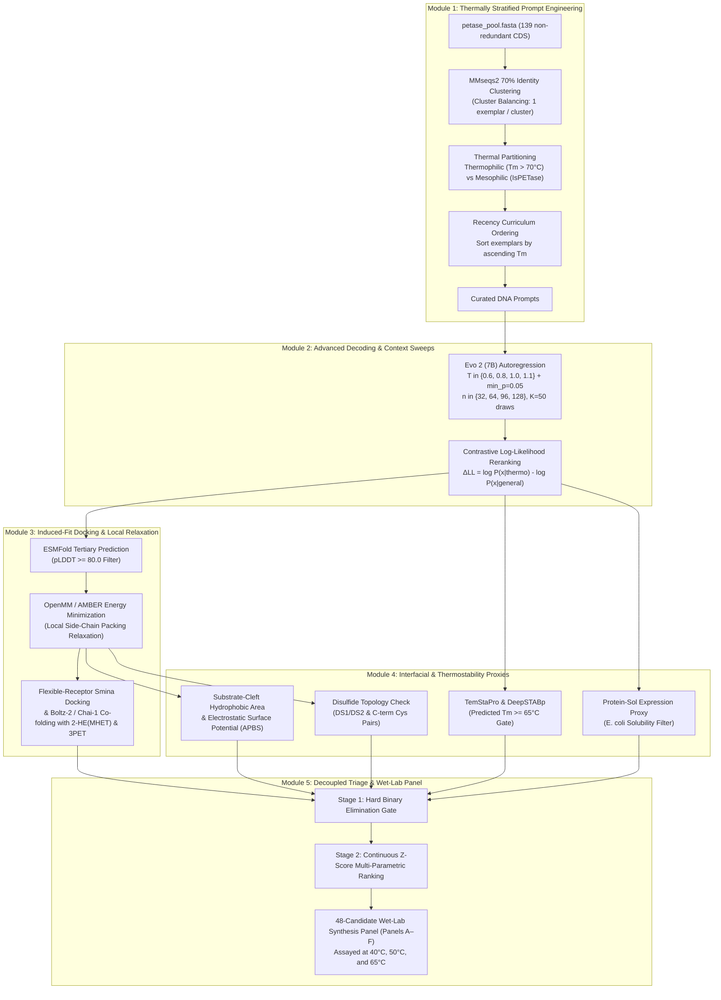

# Experiment 3: Modular Engineering & Biophysical Triage Pipeline

## Executive Overview & Architectural Philosophy

Experiment 3 addresses the 5 core bottlenecks identified in the audit of Experiments 1 and 2:
1. **Docking Rigidity & Rotamer Clashes:** Replacing static ESMFold rigid-receptor Smina docking (which caused a 98.5% near-attack conformation false-negative rate) with local energy minimization, flexible side-chain docking, and deep learning co-folding.
2. **Taxonomic & Thermal Skew:** Eradicating the 78.6% LCC clade overrepresentation via MMseqs2 70% cluster balancing and conditioning Evo 2 specifically on thermophilic cutinase exemplars ($T_m > 70^\circ\text{C}$).
3. **Score Compression:** Replacing mixed hard-penalty scoring with a two-stage decoupled triage (hard binary elimination followed by continuous Z-score ranking).
4. **Single-Point Decoding ($T=0.8$):** Mapping the novelty–validity Pareto frontier with temperature sweeps ($T \in \{0.6, 0.8, 1.0, 1.1\}$) and min-$p$ sampling (`min_p = 0.05`).
5. **Missing Polymer-Interface & Stability Proxies:** Integrating interfacial surface hydrophobicity, electrostatic cleft potential, conserved disulfide bond topology, and deep learning thermostability predictors ($T_m \ge 65^\circ\text{C}$).



---

## Module 1: Thermally Stratified & Cluster-Balanced Prompt Engineering

### 1.1 Objective
Eliminate the passive taxonomic bias toward thermophilic LCC (which comprised 78.6% of structural alignments in Exp 2) and explicitly condition Evo 2 to sample sequences tailored for high-temperature PET depolymerization near PET's glass transition temperature ($T_g \approx 65\text{–}70^\circ\text{C}$).

### 1.2 Sub-Components & Implementation Logic

#### Component 1.1: MMseqs2 70% Sequence Identity Clustering
- **Method:** Cluster `petase_pool.fasta` using MMseqs2:
  ```bash
  mmseqs easy-cluster petase_pool.fasta pool_clustered tmp --min-seq-id 0.70 -c 0.80
  ```
- **Stratified Sampling:** Prompts are drawn such that no two exemplars in the same prompt belong to the same 70% sequence cluster. This prevents heavily sampled natural clades from dominating attention heads.

#### Component 1.2: Thermal Pool Stratification
Partition the 139-member pool into curated operational sub-pools:
1. **Thermophilic Cutinase Pool ($\mathcal{P}_{\text{thermo}}$):**
   - Criteria: Experimentally validated $T_m > 70^\circ\text{C}$ or $T_{\text{opt}} \ge 65^\circ\text{C}$.
   - Core Seeds: LCC (wild-type, ICCG, WCCG), PHL7, TfCut2, BhrPETase, PES-H1, PES-H2, Cut190.
2. **Mesophilic / Engineered *Is*PETase Pool ($\mathcal{P}_{\text{meso}}$):**
   - Criteria: *Ideonella sakaiensis* scaffold ($T_m \approx 45\text{–}57^\circ\text{C}$).
   - Core Seeds: Wild-type *Is*PETase, Fast-PETase, HotPETase, DuraPETase, ThermoPETase.
3. **General Background / Negative Pool ($\mathcal{P}_{\text{general}}$):**
   - Criteria: Non-PET esterases and general $\alpha/\beta$-hydrolases for contrastive likelihood evaluation.

#### Component 1.3: Recency / Curriculum Prompt Biasing
In autoregressive transformer generation, tokens closest to the generation prefix exert stronger conditioning influence.
- **Curriculum Order:** Exemplars in each prompt are sorted in strictly ascending order of thermostability ($T_m$ or $T_{\text{opt}}$):
  $$\text{Exemplar}_1 (T_m = 48^\circ\text{C}) \longrightarrow \text{Exemplar}_2 (T_m = 60^\circ\text{C}) \longrightarrow \cdots \longrightarrow \text{Exemplar}_n (T_m \ge 75^\circ\text{C}) \longrightarrow \text{Continuation}$$
- **Prompt Structure:**
  ```
  GGGGGGGG <CDS_1> GGGGGGGG <CDS_2> ... GGGGGGGG <CDS_n> GGGGGGGG <Continuation>
  ```

### 1.3 Module Inputs & Outputs
- **Inputs:** `petase_pool.fasta`, `petase_codons.json`, metadata annotations ($T_m$, $T_{\text{opt}}$, specific activity).
- **Outputs:** Stratified prompt dictionaries (`prompts_thermo.json`, `prompts_meso.json`, `prompts_contrastive.json`).

---

## Module 2: Advanced Autoregressive Decoding & Context Scaling Sweeps

### 2.1 Objective
Map the novelty–validity Pareto frontier, determine the exact context depth ($n$) where sequence memorization spikes, and contrastively enrich sequences with thermophilic regulatory determinants.

### 2.2 Sub-Components & Implementation Logic

#### Component 2.1: Min-$p$ & Temperature Decoding Sweep
Fixed temperature ($T=0.8$) and top-$k=4$ restrict exploration of viable chemical space:
- **Temperature Sweep:** $T \in \{0.6, 0.8, 1.0, 1.1\}$.
- **Min-$p$ Filtering (`min_p = 0.05`):**
  A token $x_i$ is considered only if:
  $$P(x_i) \ge \text{min\_p} \times \max_{j} P(x_j)$$
  In nucleotide coding sequences, this prevents out-of-frame nonsense mutations while maintaining high diversity at loop and surface positions.
- **Top-$p$ Truncation:** Set `top_p = 0.92`.

#### Component 2.2: Context Depth ($n$) vs. Number of Draws ($K$) Scaling
- **Context Depth Grid:** $n \in \{32, 64, 96, 128\}$.
- **Prompt Scaling ($K$):** Expand from 10 draws to $K = 50\text{–}100$ independent stratified draws per depth.
- **Memorization Cliff Detection:** Monitor mean maximum percent identity ($\overline{\max \text{PID}}$). The memorization cliff is reached when $\overline{\max \text{PID}} > 80.0\%$ and novel yield ($< 85\%$ identity) drops by $> 25\%$.

#### Component 2.3: Contrastive Log-Likelihood Reranking
Isolate sequences that specifically leverage thermophilic motifs rather than generic hydrolase patterns:
$$\Delta \text{LL}(x) = \log P_{\text{Evo2}}(x \mid \text{Prompt}_{\text{thermo}}) - \log P_{\text{Evo2}}(x \mid \text{Prompt}_{\text{general}})$$
Higher $\Delta \text{LL}$ indicates strong statistical enrichment for thermophilic sequence grammar.

### 2.3 Module Inputs & Outputs
- **Inputs:** Conditioned DNA prompt suites from Module 1.
- **Outputs:** Generation tables containing raw nucleotide continuations, log-likelihood scores, and parsed mature amino acid sequences.

---

## Module 3: Upgraded Structural Relaxation & Induced-Fit Docking

### 3.1 Objective
Eliminate the severe near-attack conformation (NAC) false-negative rate (where 69/70 designs failed strict NAC despite valid binding energies) caused by static side-chain rotamers in predicted ESMFold structures blocking the catalytic Ser $O\gamma$.

### 3.2 Sub-Components & Implementation Logic

#### Component 3.1: Fast Local Energy Relaxation (OpenMM / AMBER)
Before molecular docking or spatial measurement, tertiary models undergo constrained local energy minimization:
- **Tool:** OpenMM with AMBER14SB forcefield.
- **Protocol:** Heavy backbone atoms ($N, C\alpha, C, O$) restrained with a harmonic potential ($k = 10\text{ kcal/mol}\cdot\text{\AA}^2$), allowing side chains to resolve steric strain and relax into physical rotamer minima.

#### Component 3.2: Flexible Side-Chain Smina Docking
- **Receptor Flexibility:** Set active-site catalytic and binding residues to flexible during docking:
  - Catalytic Triad: Nucleophilic Ser ($O\gamma$), His ($N\epsilon2$), Asp ($O\delta$).
  - Oxyanion Hole: Tyr / Met backbone NH.
  - Substrate Clamp: Trp159 / Trp185 equivalents.
- **Ligands:**
  1. **2-HE(MHET):** Mono-(2-hydroxyethyl) terephthalate.
  2. **3PET:** Trimeric PET fragment ($\text{HE(MHET)}_3$), representing the solid plastic surface interface.
- **Attack Geometry:** Nucleophilic attack distance ($d_{\text{attack}}$) measured from Ser $O\gamma$ to the electrophilic ester carbonyl carbon ($C_{\text{ester}}$) using SMARTS query:
  ```smarts
  [CX3](=O)[OX2][CH2]
  ```
- **Near-Attack Conformation (NAC) Criteria:**
  $$d_{\text{attack}} \le 3.5\text{ \AA} \quad \text{and} \quad \theta_{\text{Bürgi-Dunitz}} = \angle(O\gamma \cdots C_{\text{ester}} = O) \in [95^\circ, 115^\circ]$$

#### Component 3.3: Deep Learning Co-Folding (Boltz-2 / Chai-1 / AlphaFold 3)
For the top 100 designs, bypass classical docking entirely:
- Co-fold the protein directly in the presence of 2-HE(MHET) and 3PET ligands.
- Captures induced-fit cleft restructuring and authentic side-chain reorientation.

### 3.3 Module Inputs & Outputs
- **Inputs:** Translated candidate FASTA files.
- **Outputs:** Relaxed PDB coordinates, flexible docked ligand poses (PDBQT/SDF), binding affinities ($\Delta G_{\text{bind}}$), attack distances ($d_{\text{attack}}$), and Bürgi-Dunitz angles.

---

## Module 4: Solid-Polymer Interfacial Adsorption & Thermostability Proxies

### 4.1 Objective
Evaluate the physical prerequisites for enzymatic degradation of insoluble, semi-crystalline PET: interfacial surface adsorption, thermal resistance near $T_g$, and soluble bacterial expression.

### 4.2 Sub-Components & Implementation Logic

#### Component 4.1: Interfacial Adsorption & Cleft Hydrophobicity
- **Method:** Surface analysis of the substrate-binding cleft using RDKit and FreeSASA:
  - **Hydrophobic Patch Area ($A_{\text{cleft\_hp}}$):** Solvent-accessible surface area of exposed hydrophobic residues (Trp, Phe, Tyr, Leu, Ile, Val) within 8 Å of the catalytic triad.
  - **Electrostatic Surface Potential (APBS):** Net electrostatic charge around the binding groove (neutral-to-positive cleft promotes polyester chain alignment).

#### Component 4.2: Disulfide Bond Topology Audit
Disulfide bonds provide thermal stability in known PET hydrolases:
- **Scan:** Identify conserved cysteine pairs within $\le 3.0\text{ \AA}$ ($S\gamma\text{–}S\gamma$ distance):
  - **C-terminal Disulfide:** Conserved in thermophilic cutinases (e.g., Cys274–Cys290 in LCC and TfCut2; $T_m > 70^\circ\text{C}$).
  - **Active-Site Disulfides (`DS1`, `DS2`):** Conserved in *Is*PETase adjacent to the catalytic triad.

#### Component 4.3: Deep Learning Thermostability Predictors
- **TemStaPro:** Predicts melting temperature bins ($T_m > 65^\circ\text{C}$) directly from ESM2 residue embeddings.
- **DeepSTABp:** Predicts numerical $T_m$ values ($\ge 65.0^\circ\text{C}$ threshold).

#### Component 4.4: Bacterial Expression & Solubility Gate
- **Protein-Sol:** Predicts soluble expression in *Escherichia coli* (filter: predicted solubility $> 0.45$).
- Prevents spending synthesis budget on insoluble inclusion bodies.

### 4.3 Module Inputs & Outputs
- **Inputs:** Relaxed tertiary PDB structures and amino acid sequences.
- **Outputs:** Tabular biophysical features (`cleft_hydrophobic_sasa`, `net_charge_cleft`, `disulfide_count`, `predicted_tm`, `solubility_score`).

---

## Module 5: Decoupled Multi-Parametric Triage & Controlled Wet-Lab Selection

### 5.1 Objective
Replace the v1 scoring formula (where a hard `-28.2` penalty outlier compressed viable candidates into a 0 to +0.71 band) with a two-stage decoupled screening pipeline, selecting a balanced 48-candidate experimental testing panel.

### 5.2 Sub-Components & Implementation Logic

#### Component 5.1: Stage 1 — Hard Binary Plausibility Elimination
Candidates must pass all binary gates to be considered viable:
$$\text{Gate} = \left(\text{pLDDT} \ge 80.0\right) \land \left(\text{SeqTriad}_{\text{Ser,Asp,His}} = \text{True}\right) \land \left(241 \le L \le 306\right) \land \left(\text{Solubility} \ge 0.45\right)$$
Failing sequences are logged and dropped prior to calculating continuous composite scores.

#### Component 5.2: Stage 2 — Continuous Z-Score Composite Ranking
For all gate-passers, metrics are standardized into Z-scores ($Z(X) = \frac{X - \mu_X}{\sigma_X}$) across the passing cohort:
$$\text{Fitness Score} = 0.25\,Z(\text{pLDDT}) + 0.20\,Z(\text{TM}_{\text{ref}}) + 0.20\,Z(-\Delta G_{\text{bind}}) + 0.15\,Z(\text{NAC}) + 0.10\,Z(\hat{T}_m) + 0.10\,Z(A_{\text{cleft\_hp}})$$
This preserves dynamic range and ranking fidelity across all structural and physical terms.

#### Component 5.3: Controlled 48-Target Wet-Lab Validation Panel

| Panel Arm | Target Count | Selection Algorithm | Scientific Function |
| :--- | :---: | :--- | :--- |
| **Panel A: Thermostable Structural Leads** | 12 | Top continuous Z-score with predicted $T_m \ge 70^\circ\text{C}$ and relaxed $d_{\text{attack}} \le 3.5\text{ \AA}$ | Primary high-temperature PET degradation candidates ($65^\circ\text{C}$). |
| **Panel B: Deep Sequence Novelty** | 12 | Farthest-point clustering on identity ($50\%\text{–}65\%$) among gate-passers | Explore novel evolutionary space unmapped by natural enzymes. |
| **Panel C: IsPETase Groove Rescues** | 8 | Top scorers retaining the *Is*PETase Trp159 groove coupled with thermophilic core packing | Test hybrid mesophilic-cleft / thermophilic-scaffold designs. |
| **Panel D: Random Gate-Passers** | 6 | Uniform random selection of passing candidates | In silico null control: verifies computational ranking outperforms random draws. |
| **Panel E: Catalytic Ser$\rightarrow$Ala Knockouts** | 4 | Inactivating point mutations at catalytic serine of top Panel A leads | Validates true catalytic turnover vs. abiotic polymer adsorption. |
| **Panel F: Natural Reference Standards** | 6 | LCC, ICCG, PHL7, TfCut2, wild-type *Is*PETase, Fast-PETase | Gold-standard kinetic benchmarks across temperature windows. |

#### Component 5.4: In Vitro Experimental Validation Matrix
Selected designs will be synthesized, cloned into pET-28a(+), expressed in *E. coli* BL21(DE3), purified via Ni-NTA, and tested under standardized conditions:
1. **Activity on Model Substrate (p-NPB):** Kinetic constants ($k_{\text{cat}}, K_m$) measured via absorbance at 405 nm ($25^\circ\text{C}\text{–}65^\circ\text{C}$).
2. **Post-Consumer PET Powder Depolymerization:** 10 mg/mL crystalline PET powder incubated with 1 $\mu\text{M}$ enzyme across three temperatures:
   - **$40^\circ\text{C}$:** Mesophilic activity baseline.
   - **$50^\circ\text{C}$:** Intermediate thermal transition.
   - **$65^\circ\text{C}$:** PET glass transition point ($T_g$).
3. **Product Quantification:** Reverse-phase HPLC tracking release of terephthalic acid (TPA), mono-(2-hydroxyethyl) terephthalate (MHET), and bis(2-hydroxyethyl) terephthalate (BHET).
4. **Thermostability Measurement:** Differential Scanning Fluorimetry (DSF / nanoDSF) to determine experimental $T_m$.

---

## Deliverables & Dataset Manifest

| Module | Primary Code / Script | Key Output Artifact |
| :--- | :--- | :--- |
| **Module 1** | `mod_01_stratified_prompts.py` | `prompts_thermo_curriculum.json` |
| **Module 2** | `mod_02_evo2_sweep_runner.py` | `generated_continuations_grid.tsv` |
| **Module 3** | `mod_03_induced_fit_docking.py` | Relaxed PDBs & `smina_flexible_docking_results.tsv` |
| **Module 4** | `mod_04_biophysical_proxies.py` | `interfacial_and_stability_features.tsv` |
| **Module 5** | `mod_05_decoupled_triage.py` | `wetlab_panel_exp3_48targets.tsv` & `.faa` |
